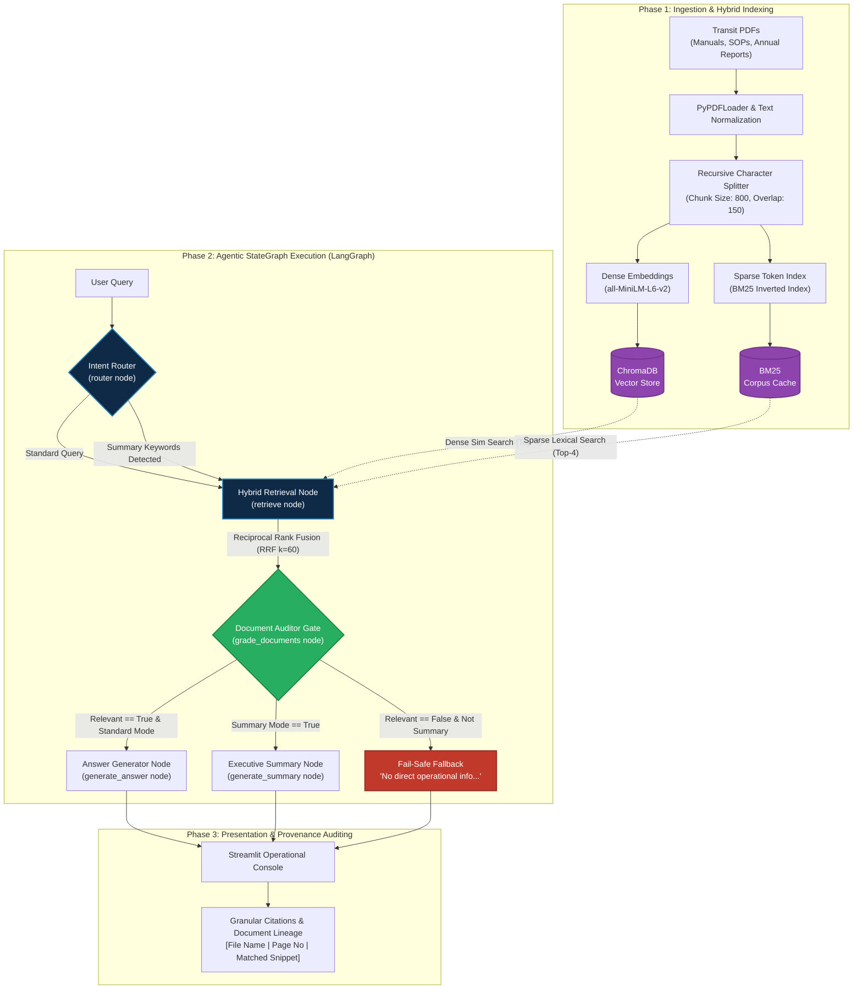
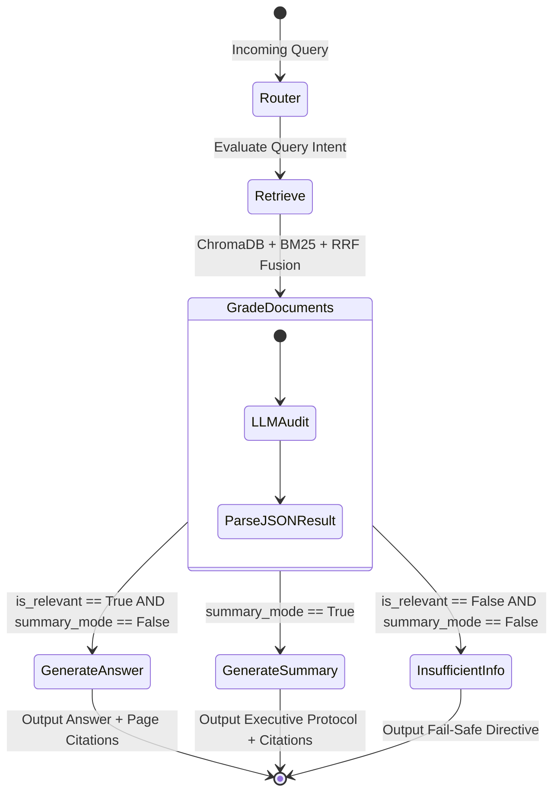

# 🚇 KMRL DocDeclutter: Autonomous Transit Document Intelligence & Verification Engine

[](https://www.python.org/)
[](https://github.com/langchain-ai/langgraph)
[](https://www.trychroma.com/)
[](https://ai.google.dev/)
[](https://streamlit.io/)

---

## 📌 Executive Summary

**KMRL DocDeclutter** is an enterprise-grade, agentic Retrieval-Augmented Generation (RAG) platform tailored for **Kochi Metro Rail Limited (KMRL)** and mission-critical Mass Rapid Transit Systems (MRTS). The system automates the ingestion, cognitive indexing, semantic-lexical search, and verification of complex, multi-modal transit documentation—ranging from regulatory annual reports, Standard Operating Procedures (SOPs), and safety bulletins to engineering specifications and fare circulars.

By coupling **Hybrid Fusion Search (ChromaDB Vector Embeddings + BM25 Lexical Keyword Ranking with Reciprocal Rank Fusion)** with a **Self-Reflective Agentic State Machine (LangGraph)**, KMRL DocDeclutter guarantees mathematically grounded factual responses while systematically eliminating large language model (LLM) hallucinations through autonomous document grading and page-level citation lineage.

---

## 🛑 Problem Statement

### 1. The Challenge in Transit Operations
Mass Rapid Transit Systems generate enormous volumes of mission-critical documentation across disparate departments:
* **Operational Guidelines & Standard Operating Procedures (SOPs)**
* **Traction Power, Signalling, and Rolling Stock Maintenance Manuals**
* **Annual Financial Audits, Ridership Metrics, and Fare Box Accounts**
* **Emergency Preparedness Protocols, Mock Drill Logs, and Safety Directives**

### 2. Operational Deficiencies of Traditional Systems
* **Information Silos & Retrieval Latency:** Station controllers, line managers, and executive engineers waste critical operational hours manually parsing multi-hundred-page PDFs to resolve operational queries.
* **Lexical vs. Semantic Mismatch:** Standard keyword search engines (like regex or basic SQL search) fail to interpret semantic context (e.g., searching for *"surveillance systems"* fails to match sections discussing *"CCTV monitoring and depot intrusion checks"*). Conversely, pure vector-based dense search struggles with exact alphanumeric identifiers, section codes, or technical IDs (e.g., *"FY 2024-25"*, *"Aluva to Pettah"*, *"Rule 4.1.2"*).
* **The Hallucination Hazard in High-Stakes Environments:** In public transit, factual inaccuracies can cause operational shutdowns, regulatory compliance breaches, or catastrophic safety incidents. Generic LLMs without deterministic grounding invent plausible yet nonexistent guidelines or metrics.
* **Absence of Verifiable Audit Trails:** Operators and statutory auditors require verifiable proof of origin—down to the exact document filename, page number, and matched excerpt.

---

## 💡 Patent Innovation Framework

> [!IMPORTANT]
> **Proposed Patent Title:**
> *System and Method for Self-Reflective Agentic Hybrid Retrieval-Augmented Generation with Verifiable Multi-Criteria Grounding in Mission-Critical Transit Operations*

### 1. Field of the Invention
The present invention pertains to the intersection of **Autonomous Artificial Intelligence Agents**, **Hybrid Information Retrieval (Sparse Lexical + Dense Semantic)**, **Natural Language Processing (NLP)**, and **Verification Auditing Systems** deployed within safety-critical public transit infrastructure.

### 2. Deficiencies of Conventional Art
Prior-art RAG implementations follow a linear "retrieve-and-generate" architecture:
1. User query is transformed into a single dense vector.
2. Nearest neighbor chunks are retrieved from a vector store.
3. Chunks are passed blindly to an LLM context window.

**Critical Flaws in Prior Art:**
* **No Validation of Retrieval Quality:** Conventional pipelines lack an autonomous, bi-directional verification node to assess whether retrieved data actually contains the factual basis required to answer the query.
* **Vulnerability to Out-of-Domain / Adversarial Inquiries:** When queried about ungrounded topics (e.g., *"underwater tunnel ticket fare for Kochi Metro Phase 3"*), conventional systems extrapolate or generate fabricated responses.
* **Single-Path Monolithic Generation:** Standard systems treat executive summaries and technical factual lookups identically, failing to adjust information density, citation rigor, or state transitions.

### 3. Novel Claims & Patentable Elements

```
                          ┌──────────────────────────────────────────────┐
                          │   Novel Patentable Claims / Inventions       │
                          └──────────────────────┬───────────────────────┘
                                                 │
         ┌───────────────────────────────────────┼────────────────────────────────────────┐
         │                                       │                                        │
         ▼                                       ▼                                        ▼
┌─────────────────────────┐           ┌─────────────────────────┐              ┌─────────────────────────┐
│ 1. Dual-Stream Hybrid   │           │ 2. Self-Reflective      │              │ 3. Deterministic        │
│    RRF Engine           │           │    Auditing Gate        │              │    Fail-Safe Routing    │
├─────────────────────────┤           ├─────────────────────────┤              ├─────────────────────────┤
│ Simultaneous dense      │           │ Autonomous binary LLM   │              │ Dynamic rejection of    │
│ MiniLM vector search +  │           │ evaluator validating    │              │ ungrounded queries;     │
│ sparse BM25 scoring     │           │ context relevance       │              │ automated referral to   │
│ with rank calibration.  │           │ before generation.      │              │ safety authorities.     │
└─────────────────────────┘           └─────────────────────────┘              └─────────────────────────┘
```

1. **Dual-Stream Hybrid Fusion with Rank-Calibrated Reciprocal Rank Fusion (RRF):**
   * Parallel execution of sparse inverted-index retrieval ($\text{BM25}$) and dense neural vector embedding retrieval ($\text{MiniLM-L6-v2}$).
   * Mathematical rank fusion using a calibrated parameter $k=60$ over chunk boundaries:
     $$\text{RRF Score}(d \in D) = \sum_{m \in M} \frac{1}{k + r_m(d)}$$
     where $M = \{\text{DenseVector}, \text{SparseBM25}\}$ and $r_m(d)$ is the document's rank in retriever $m$.
2. **Self-Reflective Document Auditing Gate (Pre-Synthesis Verification):**
   * Implementation of an autonomous evaluator node (`grade_documents`) that executes an independent semantic validation prompt before routing to generation.
   * Forces structured JSON outputs `{"relevant": true | false}` to eliminate free-form hallucination during evaluation.
3. **Dynamic Intent-Driven Graph Routing:**
   * An agentic router classifying queries between **Executive Operational Summarization** and **Granular Technical Inquiry**, dynamically modulating prompt templates, synthesis structure, and citation depth.
4. **Deterministic Fail-Safe Fallback Protocol:**
   * If retrieved context fails relevance grading, the state machine triggers an immediate escape edge (`insufficient_info`), aborting answer generation and issuing a standardized operational escalation message advising consultation with safety/operations supervisors.
5. **Deterministic Citation & Lineage Engine:**
   * Chunks maintain persistent reverse-indexing metadata (`source_name`, `page_index + 1`, character offsets), outputting an audit-ready verification log for every generated sentence.

---

## 🏗️ System Architecture

The architecture is implemented as an autonomous state machine using **LangGraph**:



### Detailed Agent State Machine Workflow



---

## 💻 Tech Stack & Engineering Components

| Layer | Technology | Version | Purpose & Architectural Justification |
| :--- | :--- | :--- | :--- |
| **Agentic Framework** | **LangGraph** | `>=0.2.14` | Cyclic state-machine graph orchestrating routers, conditional edges, self-reflection gates, and fallbacks. |
| **LLM Orchestration** | **LangChain** | `>=0.2.14` | High-level chaining, prompt templating, and document loaders. |
| **LLM Inference** | **Google Gemini** (`gemini-3.1-flash-lite`) | `>=1.0.8` | Zero-temperature, high-speed, cost-effective reasoning engine for verification and synthesis. |
| **Dense Vector Store** | **ChromaDB** | `>=0.5.5` | Embedded open-source vector store with persistent SQLite-backed storage for high-dimensional semantic search. |
| **Dense Embeddings** | **HuggingFace Sentence-Transformers** (`all-MiniLM-L6-v2`) | `>=3.0.1` | 384-dimensional dense semantic vectors capable of running low-latency local inference. |
| **Sparse Retriever** | **BM25 (`rank-bm25`)** | `>=0.2.2` | Probabilistic lexical keyword matching optimized for alphanumeric codes, metrics, and exact terminology. |
| **PDF Extraction** | **PyPDF (`pypdf`)** | `>=4.3.1` | Page-indexed document parsing with character-level coordinate preservation. |
| **Text Chunking** | **RecursiveCharacterTextSplitter** | Standard | Dynamic semantic boundary splitting (Chunk Size: 800, Overlap: 150) preserving contextual flow. |
| **User Interface** | **Streamlit** | `>=1.37.1` | Asynchronous interactive web console featuring dual-column layouts, expanders, and file management. |
| **Environment** | **python-dotenv** | `>=1.0.1` | Isolated credential management for deployment integrity. |

---

## 📂 Project Directory Structure

```plaintext
KMRL-Docdeclutter-Share 3/
├── app.py                      # Main Streamlit web application & interactive operational dashboard
├── requirements.txt            # Production Python package dependencies
├── core/                       # Core engine modules
│   ├── config.py               # Central configuration (model parameters, paths, thresholds)
│   ├── state.py                # TypedDict state schema for LangGraph agent workflow
│   ├── parser.py               # PDF document ingestion, cleaning, and recursive chunking
│   ├── retriever.py            # Hybrid retriever (ChromaDB + BM25 + Reciprocal Rank Fusion)
│   └── graph.py                # LangGraph state machine (router, grader, answer/summary synthesizers)
├── scripts/                    # Utility scripts
│   └── download_samples.py     # Automated corpus bootstrapper downloading official KMRL annual reports
├── data/                       # Document storage directory
│   └── transit_docs/           # Directory where raw operational PDFs are stored
└── chroma_db/                  # Persistent ChromaDB vector database index files
```

---

## 🚀 Installation & Setup Guide

### 1. Prerequisites
* **Python 3.10+** (Python 3.12 recommended)
* **Google Gemini API Key** ([Google AI Studio](https://aistudio.google.com/))
* **Git** installed on the local system

### 2. Clone and Setup Environment
```bash
# Clone the repository
git clone https://github.com/your-org/KMRL-Docdeclutter.git
cd KMRL-Docdeclutter

# Create a Python virtual environment
python3 -m venv venv

# Activate virtual environment
# On macOS/Linux:
source venv/bin/activate
# On Windows:
venv\Scripts\activate

# Install required dependencies
pip install --upgrade pip
pip install -r requirements.txt
```

### 3. Configure Environment Variables
Create a `.env` file in the project root:
```bash
touch .env
```
Populate `.env` with your API configuration:
```env
GOOGLE_API_KEY=your_actual_google_gemini_api_key_here
CHROMA_PERSIST_DIR=./chroma_db
DOCS_DIR=./data/transit_docs
```

### 4. Ingest Sample KMRL Operational Documents
Run the corpus bootstrap script to fetch official KMRL reports:
```bash
python scripts/download_samples.py
```

### 5. Launch the Streamlit Dashboard
```bash
streamlit run app.py
```
Open your browser at `http://localhost:8501`.

---

## 🧪 Operational Evaluation & Test Scenarios

The system has been evaluated against typical operational query patterns:

### Scenario A: Quantitative Metric Extraction (Dense + Lexical)
* **Query:** *"How many total train trips did KMRL operate in FY 2024-25, what was the fare box revenue, and how many trains were in operation?"*
* **Behavior:** BM25 targets numbers and currency figures; Dense retriever matches operational logs.
* **Output:** Precise factual figures with bracketed citations `[kmrl_annual_report_2024_25.pdf - Page 14]`.

### Scenario B: Executive Summary Generation
* **Query:** *"Summarize the security measures, surveillance systems, and mock drills conducted by KMRL across stations and depots."*
* **Behavior:** Router detects intent keyword `"summarize"`, activates `generate_summary` node, outputs a structured 3-part operational brief with source reference tables.

### Scenario C: Unfounded Query / Hallucination Prevention
* **Query:** *"What is the ticket fare from Aluva to Pettah for the Kochi Metro Phase 3 underwater tunnel?"*
* **Behavior:** Hybrid search retrieves non-matching snippets; `grade_documents` node flags context as ungrounded (`relevant: false`).
* **Output:** Deterministic fallback:
  > *"The ingested KMRL documents do not contain direct operational information on this matter. Please consult the safety head or operations supervisor."*

---

## 🔒 Security, Compliance & Governance

* **Zero Data Exfiltration:** Embeddings are generated locally using open-source sentence-transformers; document chunks are only shared with Gemini over TLS for the evaluated context window.
* **Granular Provenance:** Every response is bound to physical document page numbers, satisfying ISO 9001 quality management and transit regulatory audit compliance.
* **Deterministic Behavior:** Zero temperature parameter (`temperature=0.0`) ensures reproducible outputs across mission-critical inquiries.

---

## 👥 Contributors & Intellectual Property Notice

* **Project Name:** KMRL DocDeclutter
* **Domain:** Mass Rapid Transit Automation & Operational AI
* **Confidentiality:** This software architecture and its associated patent specifications are proprietary. Unauthorized copying, distribution, or patent claiming without explicit consent is strictly prohibited.
